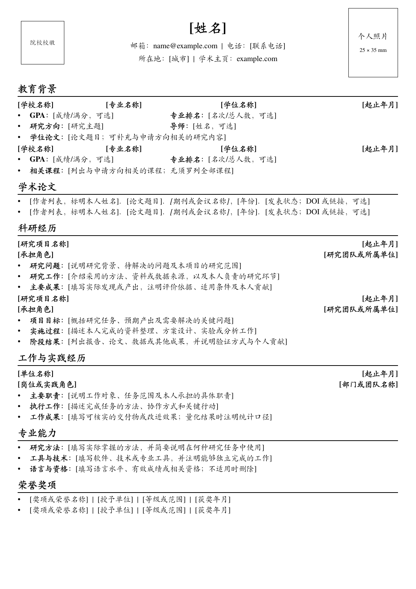
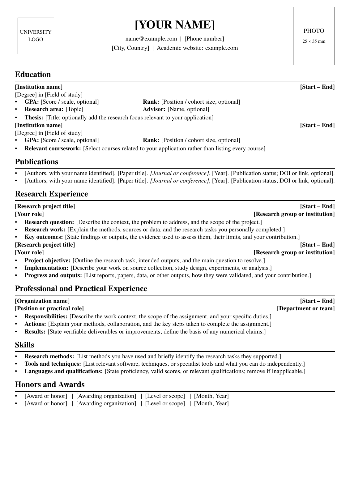

# Academic CV Templates

中英文学术简历模板，提供 LaTeX 与 Word 两种格式，适用于研究生申请、科研岗位申请及学术交流。

Bilingual academic CV templates in Chinese and English, available in LaTeX and Word, for graduate admissions, research positions, and academic exchange.

主要面向本科高年级学生、硕士生、博士生及近期毕业生。正文使用通用填写提示：将 `[...]` 替换为本人信息，删除不适用的条目即可。

## 模板预览

LaTeX 版采用 A4 单栏，左上角预留院校校徽，中间为个人信息，右上角预留照片。中英文共用样式文件；当前示例均为一页，可按内容扩展。

| 中文版 | English |
| --- | --- |
|  |  |
| [查看 PDF](examples/academic-cv-zh.pdf) · [LaTeX 源码](latex/academic-cv-zh.tex) | [View PDF](examples/academic-cv-en.pdf) · [LaTeX source](latex/academic-cv-en.tex) |

## Word 模板

经典版分行展示联系方式，紧凑版将联系方式集中展示；两种版式均提供中英文、彩色和黑白版本。Word 与 LaTeX 的版式和正文分别维护。

| 语言 | 版式 | 彩色版 | 黑白版 |
| --- | --- | --- | --- |
| 中文 | 经典版 | [下载](word/academic-cv-zh-classic-color.docx) | [下载](word/academic-cv-zh-classic-mono.docx) |
| 中文 | 紧凑版 | [下载](word/academic-cv-zh-compact-color.docx) | [下载](word/academic-cv-zh-compact-mono.docx) |
| English | Classic | [Download](word/academic-cv-en-classic-color.docx) | [Download](word/academic-cv-en-classic-mono.docx) |
| English | Compact | [Download](word/academic-cv-en-compact-color.docx) | [Download](word/academic-cv-en-compact-mono.docx) |

## 快速开始

### Word

下载对应 `.docx` 文件，用 Microsoft Word 替换个人信息和填写提示。右键左上角校徽占位图，选择“更改图片”换成本人就读或毕业院校的校徽；照片同理。不需要的图片可选中后删除。导出 PDF 后检查分页、字体和链接。

### Overleaf

上传 `latex/` 中的两个 `.tex` 文件和一个 `.cls` 文件，将编译器设为 **XeLaTeX**，选择 `academic-cv-zh.tex` 或 `academic-cv-en.tex` 为主文件即可。

### 本地编译

安装含 XeLaTeX 的 TeX Live、MacTeX 或 MiKTeX。模板使用发行版提供的 Fandol Kai 和 TeX Gyre Termes，无需额外安装商业字体。在仓库根目录运行：

```sh
make             # 编译中英文版本，更新 examples/ 中的 PDF
make zh          # 仅编译中文版，输出到 latex/build/
make en          # 仅编译英文版，输出到 latex/build/
make preview     # 更新 PDF 和预览图，另需 pdftoppm（Poppler）
make clean       # 清理辅助文件，保留 PDF
```

以上命令需要 `make` 和 `latexmk`；也可在 `latex/` 中直接执行 `xelatex academic-cv-zh.tex` 或 `xelatex academic-cv-en.tex`。

## 校徽与照片

校徽使用**申请人就读或毕业院校**的标识，保持原始比例；模板默认显示占位框。在 `latex/` 中放入自己的图片，并在对应 `.tex` 文件中取消以下命令的注释：

```tex
\setresumelogo{university-logo.png}  % 校徽：等比缩放到 22 × 22 mm 范围内
\setresumephoto{photo.jpg}          % 照片：等比缩放到 25 × 35 mm 范围内
```

无需校徽时使用 `\hideresumelogo` 隐藏校徽和占位框。`latex/university-logo.*` 与 `latex/photo.*` 已加入 Git 忽略规则。图片是否使用以申请要求为准。

## 填写建议

- 现有栏目已覆盖多数学生申请的基础内容；研究经历写清问题、本人工作、方法和结果。
- 没有论文、工作经历或奖项时，可删除对应栏目；会议报告、助教和学术服务有相关经历再加。
- 在读注明预计毕业时间，论文注明实际发表状态；中英文的日期、成果和个人贡献应一致。
- 经历较少时一页即可，内容较多时可扩展；优先遵循申请方的格式与页数要求。

更多栏目取舍与申请场景说明见[学术申请简历填写指南](docs/writing-guide.md)。字体、页边距和栏目间距可在 `latex/academic-cv.cls` 中调整。

## 目录与许可

`latex/` 保存 LaTeX 源码，`word/` 保存八种 Word 模板，`examples/` 保存示例 PDF，`docs/` 保存填写指南和预览图。文件名中的 `zh` / `en` 表示语言，`classic` / `compact` 表示版式，`color` / `mono` 表示配色。

LaTeX 源码与构建脚本沿用原模板的 [MIT 许可证](LICENSE)。Word 文档为既有模板的整理版本，原文件未附独立许可声明。字体由本地 TeX 发行版提供，本仓库不分发字体文件。

## 简历制作与学习资源

以下为外部官方资源，可结合目标院校和学科要求阅读：

- [牛津大学 Careers Service：Academic CVs](https://www.careers.ox.ac.uk/academic-cvs)：学术简历的结构、内容选择与示例，适合先了解学术申请简历应写什么。
- [Purdue OWL：Writing the Curriculum Vitae](https://owl.purdue.edu/owl/job_search_writing/resumes_and_vitas/writing_the_cv.html)：CV 的组织方式与写作建议，帮助梳理教育、研究及相关经历。
- [Overleaf：Learn LaTeX in 30 minutes](https://www.overleaf.com/learn/latex/Learn_LaTeX_in_30_minutes)：LaTeX 入门教程，适合第一次修改 `.tex` 模板的使用者。

外部指南用于学习参考；具体格式、页数及材料要求以申请单位的说明为准。
